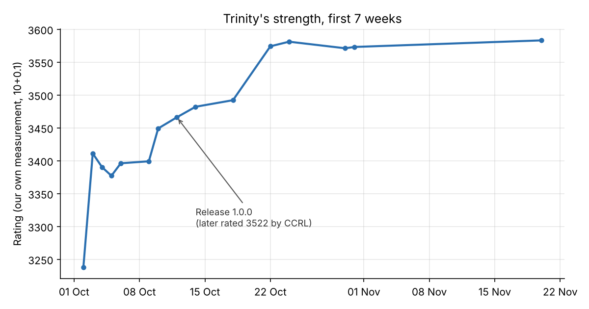

# How Trinity was built

*Ayman Mikhail, November 2026*

I'm not a programmer. Trinity was written by Claude, Anthropic's AI, and
I directed it: I set the goals and the rules, decided what to try next,
looked after the machines, and said yes or no to every change that
mattered. This page explains how that worked, with the numbers.

## Where it stands

- First commit: 30 September 2026. Release 1.0.0: 12 October 2026.
- CCRL 40/15 (list of 21 November 2026): **Trinity 1.0.0, 3522 +/- 26,
  rank 76-78**, on one CPU core, after 262 games. CCRL's page for it
  says: "LLM coded with direction, testing and review by Ayman".
- The goal I set at the start was CCRL's top 100 within a year. 1.0.0
  reached it. The new goal is the top 50 by October 2027.
- The current development version is about +75 Elo over 1.0.0 in our own
  slow-clock tests. It becomes release 1.2 in December.

## What's inside

A conventional modern engine, written from scratch in Rust: bitboards,
alpha-beta (PVS) search with pruning, reductions, extensions and history
tables, Lazy SMP, and an NNUE evaluation ((768x8 king buckets, mirrored
-> 1024)x2 -> 8 output buckets), trained from scratch with
[bullet](https://github.com/jw1912/bullet) on Leela-derived positions.
Syzygy tablebases through shakmaty-syzygy. GPL-3.0.

Nothing in it is new to the chess-programming world; the methods come
from decades of work by the people credited below. What may be new is
how it was put together.

## How it was built

**Three AI roles and one person.** "The Session" writes the code, runs the
tests and keeps the records. "Scout" proposes a few new ideas each morning.
"The advisor" is a skeptic I talk to every day: it reads the results
itself and tells me plainly what they mean, including when it was wrong.
They talk to each other through files in this repository, not through me.

**Every idea is a prediction first.** Before a change is tested, its
expected gain is written down in [ESTIMATES.md](../ESTIMATES.md). Then it
plays thousands of fast games against the current version (an SPRT test,
run free on GitHub's machines), and it is kept only if the result says so.
More than 130 such tests so far. About one idea in four passes. Most
don't, and the log keeps them all, with the predictions next to the
results, so we can see how good our guesses are.

**An outside referee, always.** Self-play gains shrink against other
engines, so every new network is also measured against four rated
engines on my PC, always next to release 1.0.0 measured the same night.

**My PC works while I sleep.** A small job runner on my desktop (RTX
3080, i9) takes jobs from a queue in this repository: network training on
the GPU at night, calibration games, test chunks. It runs under its own
restricted Windows account, can only run scripts I have approved, and
stops when I sit down at the keyboard.

**An originality rule.** From 13 October, no idea could come from reading
other engines' code, commit logs or forum posts about their techniques.
Only Trinity's own data, first principles and science from outside chess.
It is a real handicap, but it means Trinity's progress is its own. Before
release, a mechanical check compared Trinity's source with major Rust
engines, and a move-similarity test put Trinity at 77-81% agreement with
other engines, the same range unrelated engines show with each other.

## What surprised me

- **Speed.** From the first commit to a version that later rated
  top-100 took twelve days.
- **How much the boring parts matter.** The biggest gains came from
  training data and network size, and from removing pruning that was too
  aggressive, not from clever search ideas.
- **How often good-sounding ideas fail.** Three out of four. Writing the
  prediction down first kept us honest.
- **The machines.** A surprising amount of the work was keeping a home PC
  awake, idle and safe at the right hours.

## Credits

- Code: Claude (Anthropic), directed and tested by Ayman Mikhail.
- Trainer: [bullet](https://github.com/jw1912/bullet) by Jamie Whiting and
  contributors.
- Training data: Leela Chess Zero self-play positions, in the binpack form
  the Stockfish community published for its own training.
- Tablebases: Syzygy by Ronald de Man, read with shakmaty-syzygy by Niklas
  Fiekas.
- Testing: fastchess, Stefan Pohl's UHO books, python-chess, and the
  engines on the CCRL list.
- Rating: the CCRL testers.
- Ideas: the Chess Programming Wiki and the open engine community, whose
  work made all of this possible.
